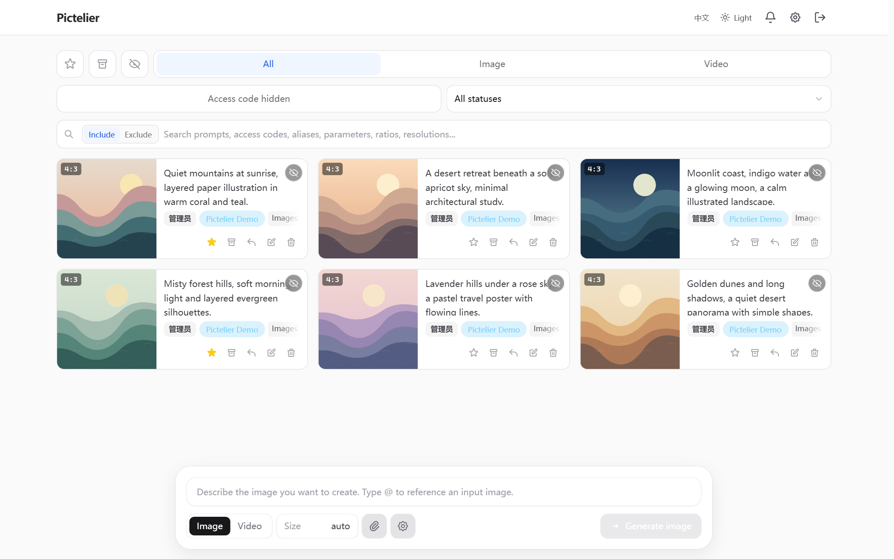
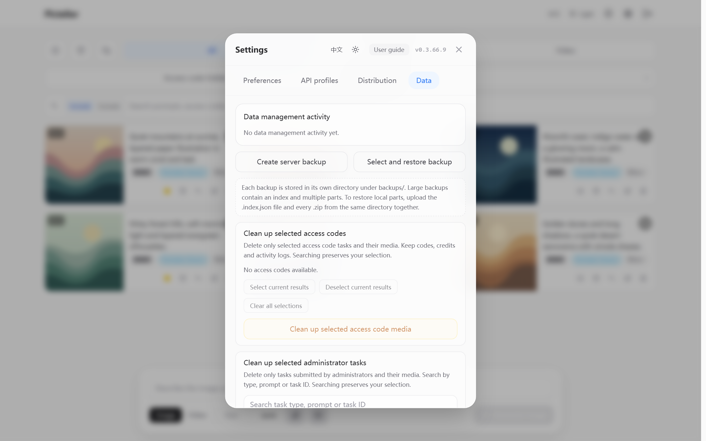

# Pictelier · 0.3.66.8

[](README.md) [](README.en.md)

Pictelier (绘坊) is an AI creative workspace that stores generated images on your own server, built on [GPT Image Playground](https://github.com/CookSleep/gpt_image_playground). Sign in to the same instance from your phone, computer, or another device to browse, download, and manage previous creations without relying on one browser’s history.

- **Server-hosted gallery and access across devices:** generated images and task records stay on your server and are available when you sign in to the same instance from another device.
- **Multiple providers:** connect Images, Responses, Videos, Venice, WaveSpeed, and Kie endpoints. Configure models and optional capabilities according to each provider's documentation.
- **Creation and editing:** generate images, edit with references, masks, and transparent markup, preview static SVGs and animated GIFs, and download original formats. Available features depend on the selected endpoint and model.
- **Tasks and assets:** retain task history, reuse prompts and input images, organize favorites and archives, perform batch actions, and back up data.
- **Administration and usage codes:** manage upstream APIs, access, and quotas centrally. Provider API keys remain on the server.
- **Localization and deployment:** Chinese and English interfaces, light and dark themes, Docker and 1Panel deployment, independent path settings, and private-network support.

**Quick navigation**

- **Overview:** [Interface preview](#section-1) · [Release notes](#release-0-3-66-8)
- **Deploy:** [Docker](#section-2) · [1Panel](#section-3)
- **Configure:** [Paths and proxies](#section-4) · [Providers](#section-5) · [Environment variables](#section-8)
- **Use and maintain:** [Appearance](#section-6) · [Tasks and data](#section-7) · [Backups](#section-9) · [Troubleshooting](#section-10)
- **Legal:** [License](LICENSE)

<a id="release-0-3-66-8"></a>

## What changes in 0.3.66.8

- Images profiles can enable **Grok API compatibility** and **Use public reference URLs** together. Single-image edits send `image.url`; multiple references use `images[].url` in their selected order at `/v1/images/edits`.
- Disabling public URLs preserves Base64 transport for Grok. Standard Images profiles retain their existing JSON URL and file-upload formats. Toggling public URLs preserves the xAI 2K setting.
- Grok single-image edits follow the reference image's aspect ratio and omit `aspect_ratio`. Multiple-image edits retain the selected aspect ratio. Resolution still follows the xAI 2K option and requested size.
- References use origin checks and signed temporary URLs. Grok image edits do not support masks.

<a id="release-0-3-66-7"></a>

## What changes in 0.3.66.7

- Chinese and English interfaces, with a language button on the login screen, main page, and Settings. The initial language follows the browser: Chinese for Chinese locales, English otherwise. Manual preferences are saved in the current browser.
- System, light, and dark appearance controls. System is the default. Theme changes use a gentle crossfade and respect reduced-motion preferences.
- Image extensions configured separately for each API profile and exact model ID. An OpenAI-compatible endpoint alone does not enable newer model features.
- Optional complexity, extended quality, transparent markup edits, SVG output, and animated GIF output. Availability follows the administrator’s manual selections for each provider and model.
- SVG remains a vector file, GIF retains animation, and downloads preserve their formats. SVG is displayed as an image after static-content checks. GIF playback is available in the full image preview.
- Repeated uploads and compressed reference reuse are fixed. Historical and new identical inputs share disk storage through hard links while keeping separate task references; deleting the last reference releases the storage. Filesystems without hard-link support retain separate files.
- Deleting tasks removes their empty media directories. Startup also removes empty directories belonging to deleted tasks, preserving other files.
- Reference URL settings retain support for private networks and display a red reminder to ensure the upstream service can access the address. A successful check confirms access from the current server only.

<a id="section-1"></a>

## Interface preview

<p align="center">
  
  
</p>

Interface preview: 0.3.66.9 with local demonstration data for the gallery and server data management.

<a id="section-2"></a>

## Docker deployment

Docker Engine and Docker Compose v2 are sufficient. The production container runs as UID/GID **1000** and listens on port **8787**. The supplied Compose template publishes it on port **8787** by default.

Create a persistent data directory for a new installation:

```bash
mkdir -p /opt/pictelier-data
chown 1000:1000 /opt/pictelier-data
```

Use [deploy/docker-compose.yml](deploy/docker-compose.yml) for a prebuilt image, or combine it with [deploy/docker-compose.build.yml](deploy/docker-compose.build.yml) to build from source. Copy [deploy/.env.example](deploy/.env.example) to `.env` beside the Compose file and set:

```dotenv
APP_SECRET=replace-with-a-stable-random-secret-at-least-32-characters
ADMIN_PASSWORD=replace-with-your-admin-login-password
APP_DATA_DIR=/opt/pictelier-data
APP_PORT=8787
```

Generate a random secret with `openssl rand -hex 32`. Keep the secret and your data directory when upgrading. API keys and encrypted data rely on the existing secret.

Start or update the application:

```bash
docker compose pull app
docker compose up -d
```

Pin the image to `ghcr.io/ettijbaqaee/pictelier:0.3.66.8` for a fixed version. `latest` follows the most recently published version. Release images target Linux amd64. The GHCR image and offline release archive contain the same application.

For offline installation, load the release archive with `docker load -i <archive.tar.gz>`, then use its image tag in Compose. Release downloads are available on the [releases page](https://github.com/EttijBaqaee/pictelier/releases).

### Building from source

Clone or download the desired version, then configure the build template:

```bash
git clone --branch v0.3.66.8 https://github.com/EttijBaqaee/pictelier.git
cd pictelier/deploy
cp .env.example .env
# Edit .env and set APP_SECRET, ADMIN_PASSWORD, and APP_DATA_DIR before starting.
docker compose -f docker-compose.yml -f docker-compose.build.yml up -d --build
```

`APP_SOURCE_DIR` must point to the source root containing `package.json`, `server/`, and `deploy/`. The standard [Dockerfile](deploy/Dockerfile) installs dependencies and builds the application inside Docker. [Dockerfile.1panel](deploy/Dockerfile.1panel) requires an existing Linux dependency cache; use the standard Dockerfile for a clean source checkout.

<a id="section-3"></a>

## 1Panel

Create a Compose application and paste the full [deployment template](deploy/docker-compose.yml). Set `APP_SECRET`, `ADMIN_PASSWORD`, and an absolute `APP_DATA_DIR` in its environment settings. Keep the container port at 8787; change the host port if needed.

Compose environment variables use either a mapping or a list. For example:

```yaml
environment:
  APP_BASE_PATH: "web"
  API_BASE_PATH: "a"
```

The equivalent list form is `- APP_BASE_PATH=web`. Do not mix the two forms. Recreate the container after changing environment variables.

<a id="section-4"></a>

## Paths and reverse proxies

Path prefixes can be changed at runtime without rebuilding the image. Plain names such as `web` and slash-wrapped names such as `/web/` are both accepted.

| Environment variable | Example | Result | Default |
| --- | --- | --- | --- |
| `APP_BASE_PATH` | `web` | `/web/` home, icons, manifest, service worker | `/` |
| `ASSETS_BASE_PATH` | `s` | `/s/assets/` scripts and styles | Home prefix |
| `API_BASE_PATH` | `a` | `/a/api/…` | `/api/…` |
| `MEDIA_BASE_PATH` | `m` | `/m/media/…` | `/media/…` |
| `REFERENCE_BASE_PATH` | `r` | `/r/references/…` | `/references/…` |
| `HEALTH_BASE_PATH` | `h` | `/h/health` and `/h/health/` | `/health` |

API, media, reference, and health prefixes are independent of the home prefix. Assets inherit the home prefix when unset; set `ASSETS_BASE_PATH=/` to serve them at `/assets/`.

Forward all configured paths to the same application, preserving their full paths and query strings. See [deploy/nginx.conf.example](deploy/nginx.conf.example). Keep API connections open for long generation requests and disable proxy buffering for server-sent events. Configure proxy upload limits to match the application limits.

Set `TRUSTED_PROXIES` to the actual proxy IP addresses or restricted CIDRs, comma-separated. It is empty by default. Only explicitly trusted proxies can supply forwarded client addresses.

<a id="section-5"></a>

## Provider setup

Log in as administrator and open **Settings → API configuration**. Add the provider URL, server-side API key, exact model name, and interface mode. Set one profile as the default. Provider-specific timeout and proxy options belong to each profile.

- **Images** submits image generation and editing requests. Ordinary edits use multipart file uploads.
- **Responses** uses a model/tool-compatible Responses endpoint.
- **Grok API compatibility** selects xAI-style image fields, aspect ratios, and resolution options. Enable it only if the provider requires that format.
- **Venice, WaveSpeed, and Kie** retain their separate request paths and capability controls.
- **Videos** provides video generation with the configured resolution and duration choices.

The request timeout is configured per provider. Existing saved profiles are not overwritten by environment initialization values.

### Optional image extensions

In an Images profile, open **Image extensions**. The switch defaults to off. Enter the exact model ID, then select only the features that this provider supports for that model.

The configuration belongs to the profile and full model name. A different model starts without selections. Changing the endpoint URL clears the extension configuration. Seedream and Grok may expose OpenAI-compatible APIs without supporting OpenAI model extensions.

Extensions are off by default; select features manually using your provider’s documentation. Selecting a feature permits its parameters to be sent; it does not confirm provider support. Unsupported requests may fail or still incur charges, so check your provider’s documentation first. Without feature selections, requests retain their existing parameters. Changing to an unconfigured model resets unavailable quality/format choices and removes optional extension fields from the draft. A markup attachment cannot be silently treated as a legacy mask; remove it or select a profile with markup enabled.

Supported extension controls:

| Control | Behavior |
| --- | --- |
| Complexity | Optional `low`, `medium`, or `high`; omitted by default |
| Extended quality | Adds `xhigh` and `max` when explicitly enabled |
| Markup | A separate transparent PNG overlay on the first reference image |
| SVG | Text-only generation, one output, no compression setting |
| GIF | Text-only generation with optional frame count and frame duration |
| SVG authoring model | Optional author model and reasoning effort; omitted when blank |

Open **Parameters → Advanced parameters** to use these controls. To annotate an image, add a reference and select **Annotate the first reference**. The editor supports freehand strokes, rectangles, arrows, an eraser, undo, and clear. The overlay has the same dimensions as the first submitted image, contains transparency, and is sent separately from the original. Markup and masks are mutually exclusive.

GIF frame limits default to 16. An administrator may raise the limit to 64 only when the provider supports it. Frame duration is 20–2000 ms. SVG/GIF do not use image-edit requests or compression settings. Reusing either format as a reference creates a raster reference while preserving the original output file.

Confirmed official model IDs include `gpt-image-2.6-sunburst` and `gpt-image-2.6-flare`. A relay may expose a different alias; configure the exact value it accepts. A name alone does not confirm that a relay implements the associated features. See the [official image guide](https://developers.openai.com/api/docs/guides/image-generation).

### Public reference URLs

For providers that require JSON image URLs, enable **Use public reference URLs** in an Images profile and enter the public origin, such as `https://example.com` or `http://public-ip:port`. Do not include a path. Grok profiles can also enable **Grok API compatibility**; Codex CLI mode remains mutually exclusive with public reference URLs.

Standard Images profiles send `images[].image_url` and optional `mask.image_url`. Grok profiles send `image.url` for one reference or `images[].url` for multiple references in their selected order, without masks. Both use `/v1/images/edits`. Disabling public URLs restores file uploads for standard Images or Base64 images for Grok. Without references, text-to-image behavior is unchanged.

Use **Check public access**, then save the profile. The application retrieves a temporary image through that origin and checks its contents without calling the provider. The reverse proxy must preserve the reference path and signed query string and must not add an extra login requirement. The check confirms access from this server; provider network access may differ.

Temporary URLs remain valid for at least one hour, or twice the configured request timeout plus 60 seconds when longer. Expired tasks need resubmission. Changing the origin or reference prefix requires another check. Keep the origin free of credentials and private query parameters.

<a id="section-6"></a>

## Language and appearance

Use the **EN / 中文** control to change language. To restore automatic selection, choose **Follow browser** in **Settings → Preferences → Interface language**.

Use the appearance control to choose system, light, or dark. System follows the browser’s preferred color scheme and updates when it changes. Theme transitions respect the operating system’s reduced-motion setting. These preferences are stored locally; switching them preserves the current prompt and form drafts.

<a id="section-7"></a>

## Usage codes, tasks, and data

Administrators can create usage codes, limit which providers they may use, set image/video quotas, and manage distribution settings. Users access only their permitted tasks and media. Tasks support reference reuse, favorites, archiving, and deletion.

The server stores its SQLite database and uploaded/generated media under `/app/data`. Persist the entire directory. Use the administrator data controls to export or restore application backups and manage media exports. Keep backup archives private because they contain application data and provider configuration.

Version 0.3.66.7 automatically checks historical input images at startup and after backup restoration, and deduplicates new uploads as well. Identical inputs share disk storage through hard links while retaining each task's image IDs, paths, permissions, order, and mask associations. Storage is released when the last reference is deleted. The data filesystem must support hard links; otherwise, separate files are preserved.

<a id="section-8"></a>

## Environment reference

| Variable | Meaning |
| --- | --- |
| `APP_SECRET` | Stable signing/encryption secret, at least 16 characters; 32+ recommended |
| `ADMIN_PASSWORD` | Web administrator login password |
| `APP_DATA_DIR` | Host persistence directory used by Compose |
| `APP_PORT` | Host port, default 8787 |
| `PORT` / `HOST` | Container listener, default 8787 / 0.0.0.0 |
| `DATA_DIR` | Container persistence root, `/app/data` in the template |
| `WEB_DIST_DIR` | Built web directory, `/app/dist` in the template |
| `CORS_ORIGIN` | Allowed origin, `*` by default; use full scheme/host/port when restricted |
| `UPLOAD_MAX_FILE_MB` | Per-file limit, default 32 MiB, range 1–1024 |
| `UPLOAD_MAX_TOTAL_MB` | Aggregate attachment limit, default 128 MiB, range 1–2048 |
| `UPSTREAM_API_URL` / `UPSTREAM_API_KEY` | Optional initial provider; both must be supplied |
| `UPSTREAM_MODEL` | Initial model, default `gpt-image-2` |
| `UPSTREAM_API_MODE` | Initial mode, default `images` |
| `UPSTREAM_TIMEOUT_SECONDS` | Initial provider timeout, default 300 seconds |
| `UPSTREAM_CODEX_CLI` | Optional initial compatibility flag, default false |

Provider initialization applies when no default profile exists. For saved profiles, change the settings in the application. The path and trusted-proxy variables are described above.

<a id="section-9"></a>

## Updates and backups

1. Export a backup and record the current image tag, data mount, `APP_SECRET`, password, and path settings.
2. Stop the container before copying the entire persistent directory, including SQLite WAL/SHM files if present.
3. Confirm that UID/GID 1000 can read and write the entire persistent directory, including its existing database and media files.
4. Keep the original data mount and secret, update the image tag, then recreate the container. Database schema changes are applied automatically.
5. Open the configured application path and confirm that the existing tasks and provider profiles are present.

For `SQLITE_READONLY` or `EACCES`, confirm that `/app/data` is mounted read-write and that UID/GID 1000 can write the database, its WAL/SHM files, and all media directories. Stop the application and back up the data directory, then run the following as root in the actual Compose directory:

```bash
set -e
docker compose stop app
docker compose run --rm --no-deps --user 0:0 \
  --cap-add CHOWN --cap-add FOWNER --cap-add DAC_OVERRIDE \
  --entrypoint sh app -eu -c \
  'chown -Rh 1000:1000 /app/data && chmod -R u+rwX /app/data'
docker compose up -d app
docker compose logs --tail=50 app
```

`app` is the template's service name. The one-off container uses the service's data mount and adjusts ownership and owner permissions. Include the same `-f` files in every command when using an override. A read-only mount or host filesystem must be corrected before changing file permissions.

Use your actual persistence path. Do not replace it with a new empty directory, and do not remove the volume during an upgrade. To roll back after a schema change, restore the matching pre-upgrade backup together with its original image.

<a id="section-10"></a>

## Troubleshooting

- **Empty history after upgrading:** check the host data mount and original `APP_SECRET`.
- **Permission errors:** make all existing persistent files writable by UID/GID 1000.
- **404 for scripts, media, or API:** check each independent prefix and proxy route.
- **Uploads rejected:** align application and proxy size limits. The backend rejects over-limit uploads with HTTP 413.
- **Long tasks stop early:** increase the profile request timeout and reverse-proxy timeouts as needed.
- **Unsupported extension:** confirm the exact provider/model selection and its feature switches. OpenAI compatibility alone is insufficient.
- **Clipboard unavailable:** use HTTPS or localhost and allow clipboard access. Copying SVG/GIF produces a PNG clipboard image; downloading preserves the original.

For the full Chinese deployment examples and previous release notes, see [README.md](README.md).
