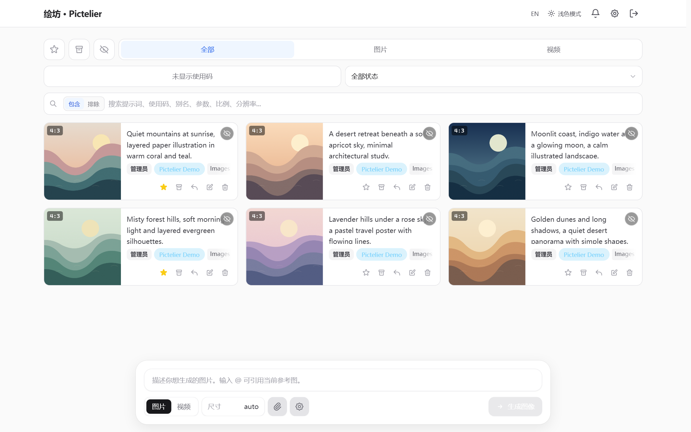
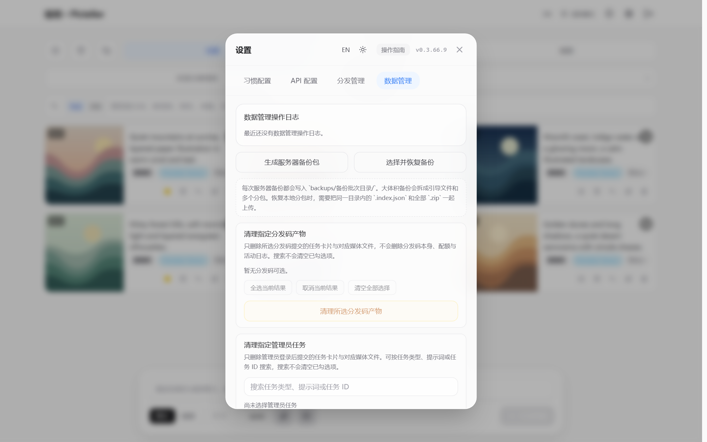

# 绘坊 · Pictelier · 0.3.66.9

[](README.md) [](README.en.md)

绘坊（Pictelier）是一款可自部署的 AI 图像与视频生成工作台，基于 [GPT Image Playground](https://github.com/CookSleep/gpt_image_playground) 开发。它将多家上游服务集中到同一界面，方便管理创作任务、参考图片和访问额度。

- **多供应商接入**：支持 Images、Responses、Videos、Venice、WaveSpeed 和 Kie 等接口模式；按供应商文档配置模型与扩展能力。
- **图像创作与编辑**：支持文生图、参考图编辑、遮罩和透明标注层，以及 SVG 静态预览、GIF 动画预览与原格式下载。具体能力取决于所选接口和模型。
- **任务与素材管理**：保存任务历史、复用提示词和输入图片，支持收藏、归档、批量操作与数据备份。
- **后台与使用码分发**：由管理员集中配置上游 API、访问方式和额度；供应商密钥保存在服务端。
- **本地化与自部署**：提供中英文界面和明暗主题，可通过 Docker 或 1Panel 部署，支持独立路径配置及内网使用。

更名前的浏览器存储、数据目录和编排名称继续沿用。升级时保留原有数据挂载、`APP_SECRET` 和路径设置，只更新镜像地址与版本；无需为更名新建数据目录。

## Update 0.3.66.9

**2026-11-10 · 参考图传输方案。**

- **三档方案**：每个 API 配置可选择“原版不变”“无损文件扰动”或“轻微像素扰动”，默认使用原版。方案在任务创建时固定，之后切换只影响新任务。
- **独立传输副本**：启用扰动后，每次提交及重试都会生成新的传输副本；公网链接使用独立的随机路径和文件名，同一链接重复下载保持一致。文件上传、Base64 和公网 URL 均应用所选方案。
- **格式与体积**：无损文件扰动保留解码后的像素；像素档仅轻微调整 RGB，保留透明度，静态位图及 WebP 输出为 WebP，并限制最终体积，必要时有损压缩。GIF 保留动画；SVG、APNG 和动画 AVIF 请使用原版或无损方案。遮罩和标注层不做像素扰动。
- **使用边界**：扰动不能保证阻止感知哈希或图像相似度识别，极小、全透明或少色图片的像素哈希也可能重复。原始输入文件、历史任务和已有去重关系保持不变，升级继续使用原数据目录和编排设置。

## Update 0.3.66.8

**2026-11-10 · Grok 公网参考图适配。**

- **Grok 公网参考图**：Images 模式下可同时开启“Grok API 兼容”和“参考图使用公网 URL”。单图使用 `image.url`，多图按排列顺序使用 `images[].url`，提交到 `/v1/images/edits`。
- **传图方式切换**：Grok 兼容模式关闭公网 URL 时继续使用 Base64；标准 Images 模式保留原有 JSON 公网链接和文件上传格式。公网 URL 开关保留已有的 xAI 2K 设置。
- **单图编辑比例**：Grok 单图编辑由参考图决定比例，不附带 `aspect_ratio`；多图编辑继续按所选尺寸提交比例。分辨率仍由“允许 xAI 2K 图片”和尺寸选择控制。
- **配置与升级**：继续使用原有参考图地址检测、临时签名链接和访问提示，无需调整数据目录或 Docker 编排参数。Grok 编辑仍不支持遮罩。

## Update 0.3.66.7

**2026-11-09 · 中英文界面、图像扩展与输入图复用。**

- **中英文切换**：登录页、主界面和设置窗口新增 EN / 中文按钮。首次访问根据浏览器首选语言自动选择，中文语言使用简体中文，其余语言使用英文。手动选择保存在当前浏览器，切换时保留正在编辑的表单与提示词。
- **明暗主题**：默认跟随浏览器的系统配色，支持浅色、深色与跟随系统。切换使用柔和渐变；开启“减少动态效果”时直接切换。
- **恢复自动设置**：在“设置 → 习惯配置”中，将“界面语言”改为“跟随浏览器”，或将“外观”改为“跟随系统”。语言与外观选择立即生效并保存在本机。
- **英文文档**：新增 [English README](README.en.md)，两个页面顶部均提供语言切换入口。
- **图像扩展能力**：在 Images API 配置中按“当前站点配置 + 完整模型名”手动勾选规划程度、扩展质量、透明标注层、SVG、GIF 和 SVG 编写模型。默认关闭，按供应商文档手动勾选；更换 URL 会清除扩展配置，更换模型不继承勾选。勾选仅允许发送参数，不保证供应商支持；OpenAI 兼容接口也可能接入 Seedream、Grok 等模型，不支持时可能报错或仍被计费，请先确认供应商文档。未勾选扩展时保留原参数。
- **扩展参数与标注**：在“参数设置 → 扩展参数”中设置可用选项。添加参考图后可标注第一张图片，支持画笔、矩形、箭头、橡皮擦、撤销与清空。透明 PNG 标注层与原图分别提交，标注和遮罩互斥；缺少能力时会在提交前提示，不会把标注当作遮罩。
- **SVG / GIF**：仅用于无参考图的文生图；SVG 数量为 1，二者均不使用压缩率。SVG 以静态矢量图片预览，GIF 在大图预览中播放，下载保留原格式。GIF 帧数上限默认 16，供应商明确支持时可设至 64；每帧时长支持 20–2000 毫秒。复用为参考图时转为位图，原始制品保留。
- **输入图复用与去重**：修复相同图片重复上传及压缩后复用；启动时和备份恢复后自动处理历史输入图。内容相同的输入图通过硬链接共享磁盘数据，各任务的图片 ID、路径、权限、顺序和遮罩关联保持独立，删除最后一个引用后释放空间。不支持硬链接的文件系统保留独立文件。
- **空目录清理**：删除任务时清理对应的空媒体目录，启动时清理已删除任务遗留的空目录，保留其他文件。
- **参考图访问提示**：保留内网部署支持，新增红色提示，务必确保上游服务能够访问参考图地址；检测通过仅表示当前服务器可访问。

官方已公布的完整模型名为 `gpt-image-2.6-sunburst`、`gpt-image-2.6-flare`。中转别名需按供应商实际值填写，再明确配置能力。详见 [OpenAI 图像文档](https://developers.openai.com/api/docs/guides/image-generation)。

---

<p align="center">
  
  
</p>

## 1. 获取 Docker 镜像（推荐）

服务器只需 Docker Engine 和 Docker Compose v2，可直接拉取绘坊的镜像，无需安装 Node.js 或在宿主机编译：

```bash
docker pull ghcr.io/ettijbaqaee/pictelier:0.3.66.9
# 跟随绘坊的最新发布版本
docker pull ghcr.io/ettijbaqaee/pictelier:latest
```

正式部署建议固定 `0.3.66.9`。本次发布镜像为 **Linux amd64**，容器使用 UID/GID 1000。GHCR 镜像与 Release 离线镜像使用相同应用内容，不是另行编译的版本。

### 首次创建持久化目录

以下命令由 root 执行，为新部署创建数据目录：

```bash
mkdir -p /opt/gpt-image-playground-data
chown 1000:1000 /opt/gpt-image-playground-data
```

如果已有部署，继续使用原数据目录，不要新建空目录替代它。**从 0.3.66 升级前，必须检查整个旧数据目录的权限；只修改最外层目录不够。** 旧版默认以 root 运行，绘坊的镜像使用 UID/GID 1000，具体迁移命令见第 10 节。

### 可选：获取源码并在 Docker 内构建

只有需要自行构建时才需要 Git，以及访问基础镜像、npm 和 Debian 软件源：

```bash
git clone --branch v0.3.66.9 https://github.com/EttijBaqaee/pictelier.git /opt/gpt-image-playground
cd /opt/gpt-image-playground/deploy
cp .env.example .env
```

也可以从 [0.3.66.9 Release](https://github.com/EttijBaqaee/pictelier/releases/tag/v0.3.66.9) 下载源码包并解压；`APP_SOURCE_DIR` 应指向含 `package.json`、`server/` 和 `deploy/` 的源码根目录。

标准源码构建使用 `deploy/Dockerfile`，依赖安装、前端编译和后端编译都在 Docker 内完成。`deploy/Dockerfile.1panel` 是已有 Linux 锁定依赖缓存环境的构建文件，不能直接用于没有 `node_modules` 的干净源码；首次部署请使用标准 `deploy/Dockerfile`。

## 2. 完整编排文件

仓库内模板为 [`deploy/docker-compose.yml`](deploy/docker-compose.yml)。可以直接用于命令行，也可以粘贴进 1Panel 编排编辑器：

**下面的 `environment` 使用映射格式：`APP_BASE_PATH: "值"`，前面不加 `-`。** 如果已有编排使用列表格式，应写成 `- APP_BASE_PATH=值`。不能写成 `- APP_BASE_PATH:/gpt_image_playground/`；两种正确写法和完整路径示例见第 6 节。

```yaml
# 必填变量：APP_SECRET、ADMIN_PASSWORD；其余变量均可选，未填写时使用下方默认值。
# ${变量:-默认值} 从同目录 .env 或 1Panel 编排环境变量读取；也可将整个引号内的值改为实际值。
# 例如 APP_BASE_PATH: "web"；留空请写 ""。修改变量后需重新创建容器才能生效。
name: gpt-image-playground-fork # 可选：编排项目名；同一服务器部署多套时使用不同名称。

services:
  app:
    # 镜像：推荐固定此版本；可按需改为绘坊的其他已发布标签。
    image: ghcr.io/ettijbaqaee/pictelier:0.3.66.9
    # 可选：本机没有镜像时才拉取；升级时主动执行 docker compose pull app。
    pull_policy: if_not_present
    container_name: gpt-image-playground-fork # 可选：容器名；部署多套时必须各不相同。
    restart: unless-stopped # 可选：异常退出或重启服务器后自动启动，手动停止除外。
    ports:
      # APP_PORT 可选，默认 8788：左侧为宿主机端口；右侧容器端口保持 8787。
      - "${APP_PORT:-8788}:8787"
    environment:
      # 以下路径参数均可选；可填 web 或 /web/ 这样的形式。
      # 主页前缀（含图标、manifest、Service Worker）：web → /web/；默认留空 → /。
      APP_BASE_PATH: "${APP_BASE_PATH:-}"
      # JS/CSS 等构建资源前缀：s → /s/assets/；留空沿用主页前缀以兼容旧版；填 / → /assets/。
      # 可单独设置，不需要重新构建镜像。assets 末尾段保持不变。
      ASSETS_BASE_PATH: "${ASSETS_BASE_PATH:-}"
      # 以下四个后端前缀互相独立，留空均不继承主页前缀。
      # API 前缀：a → /a/api/…；默认留空 → /api/…。
      API_BASE_PATH: "${API_BASE_PATH:-}"
      # 媒体前缀：m → /m/media/…；默认留空 → /media/…。
      MEDIA_BASE_PATH: "${MEDIA_BASE_PATH:-}"
      # 可选：供应商公网参考图的独立前缀：r → /r/references/…；默认留空 → /references/…。
      # 仅开启“参考图使用公网 URL”的节点使用；反代保留完整路径和签名参数，修改后需重新检测。
      REFERENCE_BASE_PATH: "${REFERENCE_BASE_PATH:-}"
      # 健康检查前缀：h → /h/health 和 /h/health/；默认留空 → /health 和 /health/。
      HEALTH_BASE_PATH: "${HEALTH_BASE_PATH:-}"
      # 可选：默认留空，不信任转发 IP；只填实际反向代理 IP 或受限 CIDR，多个值用逗号分隔。
      TRUSTED_PROXIES: "${TRUSTED_PROXIES:-}"
      # 可选：单文件上传上限，默认 32 MiB；填写 1–1024 的整数。
      UPLOAD_MAX_FILE_MB: "${UPLOAD_MAX_FILE_MB:-32}"
      # 可选：单次上传累计上限，默认 128 MiB；填写 1–2048 的整数。
      UPLOAD_MAX_TOTAL_MB: "${UPLOAD_MAX_TOTAL_MB:-128}"
      # 以下为容器内部运行设置，建议保持原值，避免与端口、挂载和健康检查不一致。
      NODE_ENV: production
      PORT: "8787"
      HOST: "0.0.0.0"
      DATA_DIR: /app/data
      WEB_DIST_DIR: /app/dist
      # 必填：固定的随机会话签名密钥，至少 16 字符，建议 32 字符以上；升级继续使用原值。
      # 可执行 openssl rand -hex 32 生成；填入 .env 或 1Panel 环境变量，勿提交到仓库。
      APP_SECRET: "${APP_SECRET:?Set APP_SECRET in .env}"
      # 必填：应用网页登录管理员密码，与服务器和 1Panel 密码无关；升级保留原值。
      ADMIN_PASSWORD: "${ADMIN_PASSWORD:?Set ADMIN_PASSWORD in .env}"
      # 可选：跨域允许来源，默认 *；限定时填写完整协议、域名和端口，不含路径前缀。
      CORS_ORIGIN: "${CORS_ORIGIN:-*}"
      # 以下供应商初始化参数全部可选；URL 和 KEY 同时填写才启用，也可留空后在网页中配置。
      # 供应商 API 地址与密钥，按供应商的接入说明填写。
      UPSTREAM_API_URL: "${UPSTREAM_API_URL:-}"
      UPSTREAM_API_KEY: "${UPSTREAM_API_KEY:-}"
      # 可选：初始化模型名称，默认 gpt-image-2，按供应商支持的模型填写。
      UPSTREAM_MODEL: "${UPSTREAM_MODEL:-gpt-image-2}"
      # 可选：接口模式，默认 images；支持 images/responses/videos/venice_images/wavespeed/kie。
      UPSTREAM_API_MODE: "${UPSTREAM_API_MODE:-images}"
      # 可选：首次初始化节点的请求超时，单位秒，默认 300；填写正整数。
      # 已有节点请在网页的供应商/API 配置中修改“请求超时”，此变量不会覆盖已保存节点。
      UPSTREAM_TIMEOUT_SECONDS: "${UPSTREAM_TIMEOUT_SECONDS:-300}"
      # 可选：Codex CLI 兼容开关，默认 false；仅对应供应商要求时设为 true。
      UPSTREAM_CODEX_CLI: "${UPSTREAM_CODEX_CLI:-false}"
    volumes:
      # APP_DATA_DIR 可选，默认 ../docker-data（相对编排文件目录）；1Panel 推荐填写绝对路径。
      # 左侧为宿主机持久化目录，需让 UID/GID 1000 可写；右侧保持 /app/data。
      # 升级必须继续使用原数据目录，避免进入空数据库。
      # 从 0.3.66 升级时，旧文件可能属于 root；先按 README 第 10 节一次性迁移整个目录权限。
      - "${APP_DATA_DIR:-../docker-data}:/app/data"
    # 可选安全设置，建议保留：禁止提权并移除额外 Linux capabilities。
    security_opt:
      - no-new-privileges:true
    cap_drop:
      - ALL
    mem_limit: 1536m # 可选：容器内存上限，可按服务器资源调整。
    pids_limit: 128 # 可选：容器进程数上限。
    # 可选健康检查，建议保留：自动读取 HEALTH_BASE_PATH，修改前缀无需修改脚本。
    healthcheck:
      test:
        - CMD
        - node
        - -e
        - >-
          const p=(process.env.HEALTH_BASE_PATH||'').trim().replace(/^[/]+|[/]+$/g,'');
          fetch('http://127.0.0.1:8787'+(p?'/'+p:'')+'/health')
          .then(r=>process.exit(r.ok?0:1)).catch(()=>process.exit(1))
      interval: 20s # 可选：检查间隔。
      timeout: 5s # 可选：单次检查超时。
      retries: 3 # 可选：连续失败阈值。
      start_period: 30s # 可选：启动宽限时间。
    # 可选日志轮转，建议保留，避免日志持续占用磁盘。
    logging:
      driver: json-file
      options:
        max-size: "10m" # 可选：单个日志文件上限。
        max-file: "3" # 可选：保留的日志文件数量。
```

## 3. 环境变量怎么写

命令行部署使用 `deploy/.env`。1Panel 使用该编排的环境变量编辑区，或者编排目录中的 `.env`。**不要把 `.env` 提交到 GitHub。**

下面是首次部署示例，两个密码占位符必须替换：

```dotenv
APP_SECRET=replace-with-a-long-random-secret-at-least-32-characters
ADMIN_PASSWORD=replace-with-your-admin-password
APP_PORT=8788
APP_BASE_PATH=
ASSETS_BASE_PATH=
API_BASE_PATH=
MEDIA_BASE_PATH=
REFERENCE_BASE_PATH=
HEALTH_BASE_PATH=
CORS_ORIGIN=*

# 使用绝对数据路径，避免把数据写到错误目录
APP_DATA_DIR=/opt/gpt-image-playground-data
# 仅源码构建时需要；镜像拉取部署可以不填
APP_SOURCE_DIR=

TRUSTED_PROXIES=
UPLOAD_MAX_FILE_MB=32
UPLOAD_MAX_TOTAL_MB=128
```

可用 `openssl rand -hex 32` 生成 `APP_SECRET`。如果已有部署，继续使用原来的 `APP_SECRET`、管理员密码和数据目录，不能照抄示例覆盖。

`UPSTREAM_API_URL` / `UPSTREAM_API_KEY` 可留空，登录网页后配置供应商。可选初始化参数见 [`deploy/.env.example`](deploy/.env.example)。

### 参考图使用公网 URL

需要公网参考图的供应商，可在管理员的 API 配置中开启“参考图使用公网 URL”。开关位于“返回 Base64 图片数据”下方，开启后填写“公网访问地址”，然后点击“检测公网访问”；检测通过后才允许保存。无需在 Docker 编排中添加 `PUBLIC_BASE_URL`。

- 支持 `https://example.com`、`https://example.com:8443`，也支持无证书的 `http://公网IP:端口`。只填写协议、域名或 IP、可选端口，不填主页或媒体路径。供应商必须能从外网访问该地址；部分供应商自身可能只允许 HTTPS。
- 对 Images 模式生效，可与“Grok API 兼容”同时开启，与 Codex CLI 模式互斥。没有参考图时继续使用原来的文生图请求；关闭开关后，标准 Images 使用文件上传，Grok 兼容模式使用 Base64。
- 有参考图时，后端以 JSON 请求 `/v1/images/edits`。标准 Images 使用 `images: [{"image_url":"临时公网链接"}]`，遮罩使用 `mask.image_url`；Grok 兼容模式单图使用 `image: {"url":"临时公网链接"}`，多图使用 `images: [{"url":"临时公网链接"}]`，不支持遮罩。多图均按最终排列提交，具体能力由供应商决定。
- 公网参考图使用独立的 `REFERENCE_BASE_PATH`，不继承主页或媒体前缀。编排中填 `REFERENCE_BASE_PATH: "r"`，公网地址填 `https://example.com`，生成链接就是 `https://example.com/r/references/uploads/…?ref_provider=…&ref_expires=…&ref_signature=…`；留空使用 `/references/…`。`references` 末尾段保留。
- 检测由应用后端通过所填地址读取本次随机生成的临时图片，最多等待 10 秒，并核对图片内容；不调用供应商 API。公网地址、参考图路径反代、签名查询参数或额外登录有误时无法通过。更换公网地址、重新开启开关或更换 `REFERENCE_BASE_PATH` 后需要重新检测；它验证当前服务器能通过该地址访问图片，不能保证供应商所在网络也允许访问。
- 浏览器能访问，但检测仍超时时，请检查应用容器能否回访所填公网地址和端口。防火墙、Docker 桥接网络或路由器不支持 NAT 回环时，容器可能无法访问自身映射端口；应调整回访网络或使用容器可回访的 Nginx 反代入口，再重新检测。HTTP 地址不需要证书。
- 临时链接在任务实际执行时生成，至少有效 1 小时；长请求按“两倍节点请求超时加 60 秒”延长。过期后重新提交任务会获得新链接。签名仅允许读取该节点任务的指定输入图片或遮罩，其他媒体继续要求登录；关闭节点的公网 URL 开关即可使该节点旧链接失效。

使用 Nginx 时，参考图反代必须保留完整前缀和查询参数，不应对该路径额外添加 Basic Auth 或网页登录。它只接受指定输入图片或遮罩的临时签名链接；原有媒体路径仍要求登录，不能把 `references` 改写为 `media`：

```nginx
# REFERENCE_BASE_PATH=r 时的示例；留空时改为 location ^~ /references/。
location ^~ /r/references/ {
    # proxy_pass 后不附加 URI，保留原始路径和签名参数。
    proxy_pass http://127.0.0.1:8787;
    proxy_set_header Host $host;
    proxy_set_header X-Real-IP $remote_addr;
    proxy_set_header X-Forwarded-For $proxy_add_x_forwarded_for;
    proxy_set_header X-Forwarded-Proto $scheme;
    proxy_cache off;
}
```

直接通过 `http://公网IP:端口` 访问容器时，开放相应端口即可；若 `REFERENCE_BASE_PATH` 为空，临时链接直接使用 `/references/…`。该配置只改变访问路由，现有图片仍保存在同一持久化数据目录，不需要移动文件或新增挂载。

### 请求超时与 5 分钟报错

`fetch failed | Headers Timeout Error | UND_ERR_HEADERS_TIMEOUT` 表示后端向上游请求时等待响应头超时。底层请求遵循节点设置的超时；上游网关或反向代理也可能有独立限制，只修改 Nginx 的超时不能解决所有请求超时。

已有节点需要在网页的供应商/API 配置中修改“请求超时 (秒)”并保存，再提交新任务。`UPSTREAM_TIMEOUT_SECONDS` 只在尚无默认节点时初始化“环境变量默认节点”，不会覆盖数据库中已保存的设置；重建容器也不会覆盖。

直连、HTTP/HTTPS 代理和 SOCKS 请求按配置限制一次请求从发出到完整读取正文的总时间。Images / Responses 返回结果图片 URL 时，后续下载单独使用同一个超时秒数；视频结果下载同理。它不代表整个任务的统一总时限：多图多次调用、异步轮询和重试各有自己的计时；Kie / WaveSpeed 结果 CDN 下载原有的每次 120 秒和重试规则继续保留。上游自己的网关或反代超时也仍可能更早结束请求。

## 4. 在 1Panel 中部署

1. 按第 1 节创建持久化目录并设置 UID/GID 1000 写入权限；升级时使用原目录。
2. 进入 **容器 → 编排 → 创建编排**，选择编辑编排，名称填写 `gpt-image-playground-fork`。
3. 粘贴第 2 节完整 YAML，使用 `ghcr.io/ettijbaqaee/pictelier:0.3.66.9`。
4. 在编排环境变量中填写第 3 节参数，替换 `APP_SECRET` 和 `ADMIN_PASSWORD`，`APP_DATA_DIR` 使用绝对路径。六项路径按第 6 节分别填写或留空。
5. 创建并启动，面板会拉取镜像并创建容器，不需要下载源码或现场编译。
6. 容器健康状态变为 `healthy` 后，按 `APP_PORT` 和 `APP_BASE_PATH` 访问。推荐再按第 7 节配置 Nginx/HTTPS。

### 在 1Panel 内改用源码构建

下载源码到服务器（例如 `/opt/gpt-image-playground`），在环境变量中设置 `APP_SOURCE_DIR=/opt/gpt-image-playground`，并把主编排中的 `image` / `pull_policy` 改为下面内容，同时加入 `build`：

```yaml
image: pictelier:0.3.66.9
pull_policy: never
build:
  context: ${APP_SOURCE_DIR}
  dockerfile: deploy/Dockerfile
```

这些键与主编排 `app` 下的 `ports`、`environment` 平级。源码目录必须含 `package.json`、`server/`、`deploy/Dockerfile`；`build.context` 不是 `deploy/` 或 1Panel 编排自身目录。

如果面板版本首次创建未执行构建，可在服务器终端进入 **面板管理的同一份编排目录**，执行 `docker compose build app`，再回面板启动。编排实际路径以面板显示为准，例如 `/opt/1panel/docker/compose/gpt-image-playground-fork`。不要另外建立不同数据目录的一套部署。

## 5. 命令行 Docker Compose

把第 2 节 YAML 保存为 `docker-compose.yml`，同目录创建第 3 节的 `.env`，准备好数据目录后：

```bash
docker compose config --quiet
docker compose pull app
docker compose up -d
docker compose ps
docker compose logs --tail=100 app
```

若使用仓库内模板，则在 `/opt/gpt-image-playground/deploy` 目录执行上述命令。

### 可选：从源码 Docker 构建

仓库提供 [`deploy/docker-compose.build.yml`](deploy/docker-compose.build.yml) 作为源码构建覆盖文件：

```bash
cd /opt/gpt-image-playground/deploy
docker compose -f docker-compose.yml -f docker-compose.build.yml build app
docker compose -f docker-compose.yml -f docker-compose.build.yml up -d
```

该模式使用本地镜像名 `pictelier:0.3.66.9`，不向 GHCR 上传。之后修改环境变量时仍使用相同两个 `-f` 文件。依赖安装和前后端编译均在 Docker 内完成，不需要在宿主机执行 `npm install` 或 `npm run build`。

## 6. 六项路径分别设置

所有参数都是**前缀**，不是完整 URL；`assets`、`api`、`media`、`references`、`health` 末尾段仍保留。`REFERENCE_BASE_PATH` 专用于供应商读取公网参考图。

```dotenv
APP_BASE_PATH=web
ASSETS_BASE_PATH=s
API_BASE_PATH=a
MEDIA_BASE_PATH=m
REFERENCE_BASE_PATH=r
HEALTH_BASE_PATH=h
```

假设宿主机端口是 `8788`：

| 用途 | 全部留空 | 上面的配置 |
| --- | --- | --- |
| 主页、图标、manifest、Service Worker | `http://服务器IP:8788/` | `http://服务器IP:8788/web/` |
| JS/CSS 等构建资源 | `/assets/…` | `/s/assets/…` |
| API 与 SSE | `/api/…` | `/a/api/…` |
| 媒体 | `/media/…` | `/m/media/…` |
| 供应商公网参考图（临时签名） | `/references/…` | `/r/references/…` |
| 健康检查 | `/health`、`/health/` | `/h/health`、`/h/health/` |

`ASSETS_BASE_PATH` 可选：**不设置或留空时随 `APP_BASE_PATH`**；填 `/` 表示独立使用根路径 `/assets/`；填 `s` 或 `/s/` 则为 `/s/assets/`。例如主页是 `/web/` 且 assets 留空时，资源仍为 `/web/assets/`。此参数只控制构建资源，不移动图标、manifest 或 Service Worker，也不支持跨域 CDN URL。

例如只把主页放在 `/gpt_image_playground/`，其余各项使用根路径：

```dotenv
APP_BASE_PATH=gpt_image_playground
ASSETS_BASE_PATH=/
API_BASE_PATH=
MEDIA_BASE_PATH=
REFERENCE_BASE_PATH=
HEALTH_BASE_PATH=
```

### environment 的两种正确写法

若希望六项共用 `/gpt_image_playground/` 前缀，六项都填 `gpt_image_playground` 即可；填写 `/gpt_image_playground/` 也会归一化成同样的前缀。参考图仍是独立的 `/gpt_image_playground/references/…`，普通媒体是 `/gpt_image_playground/media/…`。下例只展示路径部分，合并到已有服务的 `environment` 中，保留密码、密钥等其他设置。

**映射格式（与第 2 节完整模板一致）：**

```yaml
environment:
  APP_BASE_PATH: "gpt_image_playground"    # 可选；主页、图标、manifest、Service Worker
  ASSETS_BASE_PATH: "gpt_image_playground" # 可选；JS/CSS，也可留空以跟随主页
  API_BASE_PATH: "gpt_image_playground"    # 可选；API 与 SSE
  MEDIA_BASE_PATH: "gpt_image_playground"  # 可选；图片、视频等媒体
  REFERENCE_BASE_PATH: "gpt_image_playground" # 可选；独立的供应商公网参考图
  HEALTH_BASE_PATH: "gpt_image_playground" # 可选；健康检查
```

**列表格式（已有 `environment` 全部采用 `- KEY=value` 时使用）：**

```yaml
environment:
  - APP_BASE_PATH=gpt_image_playground    # 可选；主页
  - ASSETS_BASE_PATH=gpt_image_playground # 可选；JS/CSS，也可写 ASSETS_BASE_PATH= 以跟随主页
  - API_BASE_PATH=gpt_image_playground    # 可选；API 与 SSE
  - MEDIA_BASE_PATH=gpt_image_playground  # 可选；媒体
  - REFERENCE_BASE_PATH=gpt_image_playground # 可选；独立的供应商公网参考图
  - HEALTH_BASE_PATH=gpt_image_playground # 可选；健康检查
```

一个 `environment` 中只能选择一种格式，其他变量也必须使用相同格式。不要在已有的 `environment` 旁再添加第二个同名块。`- APP_BASE_PATH:/gpt_image_playground/` 不会给 `APP_BASE_PATH` 正确赋值；列表中应使用等号，映射中应使用冒号加空格。

以上两种正确配置得到的公开路径相同：

| 用途 | 路径 |
| --- | --- |
| 主页 | `/gpt_image_playground/` |
| JS/CSS | `/gpt_image_playground/assets/…` |
| API 与 SSE | `/gpt_image_playground/api/…` |
| 媒体 | `/gpt_image_playground/media/…` |
| 供应商公网参考图（临时签名） | `/gpt_image_playground/references/…` |
| 健康检查 | `/gpt_image_playground/health`、`/gpt_image_playground/health/` |
| PWA 配置、图标、Service Worker | `/gpt_image_playground/manifest.webmanifest`、`/gpt_image_playground/pwa-icon.svg`、`/gpt_image_playground/sw.js` |

前缀只允许字母、数字、下划线、短横线和路径分隔符；不能包含 `..`、查询参数、编码斜线或连续空路径段。四个后端前缀互相独立，未设置或留空都使用各自根路径，不继承主页前缀。修改 `REFERENCE_BASE_PATH` 后，网页中的公网访问地址须重新检测后保存。

修改后，在 1Panel 重新部署/重建容器；命令行等价操作：

```bash
docker compose up -d --force-recreate
```

**无需重新构建镜像；只重启旧容器不会读取新的 Compose 环境变量。** 这些路径与 1Panel 安全入口独立。

### 其他路径归属

- `sw.js`、`manifest.webmanifest`、`pwa-icon.svg`，以及 PWA 的 `start_url` / `scope` 继续跟随 `APP_BASE_PATH`。
- 图片编辑器动态 JS、入口 JS/CSS 和构建预加载文件跟随 `ASSETS_BASE_PATH`；不存在或错误的 assets 地址返回 404，不返回主页 HTML。
- 登录、任务、设置、使用码、公告、备份导入导出、下载接口和两类 SSE 都属于 `/api/`，统一跟随 `API_BASE_PATH`，无需另加下载或 SSE 前缀。
- 原图、遮罩、生成图片、缩略图、输入/输出视频及视频封面都属于 `/media/`，统一跟随 `MEDIA_BASE_PATH`；`uploads`、`masks`、`outputs` 和 `thumbs` 是媒体目录内部路径。
- 供应商读取参考图和遮罩，以及检测使用的临时图片，统一走独立的 `/references/`，跟随 `REFERENCE_BASE_PATH`。普通媒体访问继续要求登录，即使带上参考图签名也不会免登录。
- 外部供应商 URL、GitHub 链接、现有外部字体 CDN 和浏览器本地 `blob:` / `data:` 地址不加本应用前缀。

## 7. 推荐使用 Nginx 反代部署

**我们推荐使用 Nginx（或 OpenResty）反代部署，由反向代理统一提供域名和 HTTPS。**

### 六项统一使用 /gpt_image_playground/ 前缀的完整示例

使用第 6 节六项同前缀的编排设置后，主页、assets 和四个后端路径可以共用一个 `location`。下面按宿主机端口 `8787` 编写，即模板中设置 `APP_PORT=8787`，或使用端口映射 `"8787:8787"`。如果继续使用模板默认的宿主机端口 `8788`，把下面的上游端口改为 `8788`；Nginx 连接的是端口映射左侧的宿主机端口。

将下面内容放入域名现有的 `server { ... }` 中，替换旧的同路径 `location`，不要与旧配置重复添加：

```nginx
location = /gpt_image_playground {
    return 301 /gpt_image_playground/;
}

# 六项都设置为 gpt_image_playground；assets 也可留空以跟随主页。
location ^~ /gpt_image_playground/ {
    # 末尾不加 /，完整保留 /gpt_image_playground/ 前缀。
    proxy_pass http://127.0.0.1:8787;
    proxy_http_version 1.1;
    proxy_set_header Host $host;
    proxy_set_header X-Real-IP $remote_addr;
    proxy_set_header X-Forwarded-For $proxy_add_x_forwarded_for;
    proxy_set_header X-Forwarded-Proto $scheme;
    proxy_set_header Connection "";
    proxy_connect_timeout 300s;
    proxy_send_timeout 300s;
    proxy_read_timeout 300s;
    # 默认累计上传 128 MiB，另留 multipart 和字段开销。
    client_max_body_size 160m;
    proxy_request_buffering off;
    # 保证 SSE 任务进度及时返回，媒体继续由应用鉴权。
    proxy_buffering off;
    proxy_cache off;
}
```

此配置同时覆盖 `/gpt_image_playground/health` 和 `/gpt_image_playground/health/`，也覆盖 JS/CSS、图标、PWA 文件及独立的 `/gpt_image_playground/references/`。无需再添加 API/媒体/参考图/健康检查反代。若六项设置为不同前缀，则使用下面的分别配置示例。

### 六项分别设置的路径示例

下面假设 Nginx 运行在 Docker 宿主机，应用映射到宿主机 `8788` 端口。先设置：

```dotenv
APP_PORT=8788
APP_BASE_PATH=gpt_image_playground
ASSETS_BASE_PATH=s
API_BASE_PATH=a
MEDIA_BASE_PATH=m
REFERENCE_BASE_PATH=r
HEALTH_BASE_PATH=h
CORS_ORIGIN=https://image.example.com
```

将 `image.example.com` 替换为实际域名，`CORS_ORIGIN` 不包含路径。重新创建应用容器后，在域名现有的 `server { ... }` 中加入下面的配置。HTTPS 证书沿用站点配置。片段文件见 [`deploy/nginx.conf.example`](deploy/nginx.conf.example)。

```nginx
# 放入域名现有的 server 块；HTTPS 证书沿用站点配置。
# APP_BASE_PATH=gpt_image_playground
# ASSETS_BASE_PATH=s
# API_BASE_PATH=a  MEDIA_BASE_PATH=m  REFERENCE_BASE_PATH=r  HEALTH_BASE_PATH=h
# APP_PORT=8788；proxy_pass 末尾不加 /，保留请求的完整路径。
location = /gpt_image_playground {
    return 301 /gpt_image_playground/;
}

# 主页、图标、manifest 和 Service Worker
location ^~ /gpt_image_playground/ {
    proxy_pass http://127.0.0.1:8788;
    proxy_http_version 1.1;
    proxy_set_header Host $host;
    proxy_set_header X-Real-IP $remote_addr;
    proxy_set_header X-Forwarded-For $proxy_add_x_forwarded_for;
    proxy_set_header X-Forwarded-Proto $scheme;
    proxy_set_header Connection "";
    proxy_connect_timeout 300s;
    proxy_send_timeout 300s;
    proxy_read_timeout 300s;
}

# 独立 JS/CSS 构建资源；留空 ASSETS_BASE_PATH 时资源随主页，此段无需单独添加。
# ASSETS_BASE_PATH=/ 时改为 location ^~ /assets/；不要去掉 assets 末尾段。
location ^~ /s/assets/ {
    proxy_pass http://127.0.0.1:8788;
    proxy_http_version 1.1;
    proxy_set_header Host $host;
    proxy_set_header X-Real-IP $remote_addr;
    proxy_set_header X-Forwarded-For $proxy_add_x_forwarded_for;
    proxy_set_header X-Forwarded-Proto $scheme;
    proxy_set_header Connection "";
    proxy_connect_timeout 300s;
    proxy_send_timeout 300s;
    proxy_read_timeout 300s;
}

# API、上传和 SSE 任务进度
location ^~ /a/api/ {
    proxy_pass http://127.0.0.1:8788;
    proxy_http_version 1.1;
    proxy_set_header Host $host;
    proxy_set_header X-Real-IP $remote_addr;
    proxy_set_header X-Forwarded-For $proxy_add_x_forwarded_for;
    proxy_set_header X-Forwarded-Proto $scheme;
    proxy_set_header Connection "";
    proxy_connect_timeout 300s;
    proxy_send_timeout 300s;
    proxy_read_timeout 300s;
    # 为默认 128 MiB 文件累计限制预留 multipart / 字段开销。
    client_max_body_size 160m;
    proxy_request_buffering off;
    proxy_buffering off;
    proxy_cache off;
}

# 媒体仍由应用鉴权，不在代理层建立公共缓存。
location ^~ /m/media/ {
    proxy_pass http://127.0.0.1:8788;
    proxy_http_version 1.1;
    proxy_set_header Host $host;
    proxy_set_header X-Real-IP $remote_addr;
    proxy_set_header X-Forwarded-For $proxy_add_x_forwarded_for;
    proxy_set_header X-Forwarded-Proto $scheme;
    proxy_set_header Connection "";
    proxy_connect_timeout 300s;
    proxy_send_timeout 300s;
    proxy_read_timeout 300s;
    proxy_cache off;
}

# 独立公网参考图：应用验证临时签名；保留查询参数，不额外添加登录认证。
# REFERENCE_BASE_PATH 留空时改为 location ^~ /references/。
location ^~ /r/references/ {
    proxy_pass http://127.0.0.1:8788;
    proxy_http_version 1.1;
    proxy_set_header Host $host;
    proxy_set_header X-Real-IP $remote_addr;
    proxy_set_header X-Forwarded-For $proxy_add_x_forwarded_for;
    proxy_set_header X-Forwarded-Proto $scheme;
    proxy_set_header Connection "";
    proxy_connect_timeout 300s;
    proxy_send_timeout 300s;
    proxy_read_timeout 300s;
    proxy_cache off;
}

# 同时覆盖 /h/health 和 /h/health/；不存在的后缀由应用返回 404。
location /h/health {
    proxy_pass http://127.0.0.1:8788;
    proxy_http_version 1.1;
    proxy_set_header Host $host;
    proxy_set_header X-Real-IP $remote_addr;
    proxy_set_header X-Forwarded-For $proxy_add_x_forwarded_for;
    proxy_set_header X-Forwarded-Proto $scheme;
    proxy_set_header Connection "";
    proxy_connect_timeout 300s;
    proxy_send_timeout 300s;
    proxy_read_timeout 300s;
    proxy_cache off;
}
```

对应的公开地址为：主页 `https://image.example.com/gpt_image_playground/`、构建资源 `/s/assets/…`、API `/a/api/…`、媒体 `/m/media/…`、公网参考图 `/r/references/…`、健康检查 `/h/health` 或 `/h/health/`。

**每段 `proxy_pass` 末尾都不加 `/`，完整路径原样转发给应用。** 不同前缀需要匹配各自的 `location`；六项共用同一前缀时，可使用上一例中的单个 `location`。

若 `ASSETS_BASE_PATH` 留空，assets 随主页路径，不需要单独的 assets 段；填 `/` 时将资源段改为 `location ^~ /assets/`。如果后端四项留空，保持主页前缀不变，把四段后端 `location` 分别改为 `/api/`、`/media/`、`/references/`、`/health`。如果修改任何一个参数，只改对应的 `location` 即可。若主页也留空，则删除补斜线重定向，把主页段改成 `location /`，API/媒体/参考图等更具体的段继续保留。

API 段关闭响应缓冲和缓存，确保 SSE 实时进度及时到达；不强制发送 `Connection: upgrade`。后端是 HTTP，不需要 `proxy_ssl_server_name`、`proxy_ssl_name`。默认 `client_max_body_size 160m` 给 128 MiB 文件累计上限预留 multipart 和字段开销；应用仍检查单文件 32 MiB 和累计 128 MiB，调整应用上限时也要调整代理上限。

### 从旧反代迁移，以及资源 404 / 白屏检查

旧配置中的 `location /gpt_image_playground/` 搭配 `proxy_pass http://127.0.0.1:8787/;` 会剥掉匹配的 `/gpt_image_playground/` 前缀。设置本版路径变量后，应改成 `proxy_pass http://127.0.0.1:8787;`，让应用收到完整路径。只修改 Nginx 的访问路径不会自动设置应用环境变量；浏览器地址栏里的子路径也不会自动填入这些变量。

例如访问 `/gpt_image_playground/`，页面却请求根路径 `/assets/index-….js`、`/manifest.webmanifest` 或 `/pwa-icon.svg` 并返回 404，应按顺序检查：

1. 在浏览器查看页面源码中的 `<base href="…">` 和 `app-base-path`、`assets-base-path` 等 meta。六项统一配置时，base 应为 `/gpt_image_playground/`，原有五个 meta 的值应为 `/gpt_image_playground`；新增参考图路径由后端使用，不写入页面 meta。全部为空说明页面仍按默认根路径运行；只有 assets 为空也可能是显式配置了根路径 `/`，需对照实际设置。
2. 核对 Compose 写法：映射用 `APP_BASE_PATH: "gpt_image_playground"`，列表用 `- APP_BASE_PATH=gpt_image_playground`，不要使用冒号列表。修改后重新创建容器，单纯重启不能更新环境变量。
3. 核对 Nginx 的上游端口和路径：请求进入应用前必须保留已配置的前缀。六项共用前缀时可直接使用上面的完整示例；后端四项独立留空时，则仍需代理根路径 `/api/`、`/media/`、`/references/` 和 `/health`。
4. 在浏览器开发者工具的 Network 中核对入口 JS、CSS、动态加载的编辑器、manifest 和图标。JS/CSS 应返回对应资源，不能返回 404 或主页 HTML。修正后强制刷新页面；安装过旧 PWA 时，如仍加载旧内容，再注销该应用的旧 Service Worker 并重新打开。

使用第 2 节模板时，可在编排目录执行以下命令，只查看六项路径变量，避免把含密钥的全部环境变量贴到公开日志：

```bash
docker compose exec -T app node -e 'for (const k of ["APP_BASE_PATH","ASSETS_BASE_PATH","API_BASE_PATH","MEDIA_BASE_PATH","REFERENCE_BASE_PATH","HEALTH_BASE_PATH"]) console.log(k + "=" + JSON.stringify(process.env[k] ?? ""))'
```

其中 `app` 是模板服务名；若自行修改过服务名，应使用实际名称。容器内变量正确但公开页面 meta 仍为空时，还要检查 Nginx 是否转发到了旧容器、错误的端口或其他编排实例。

### 修改前缀后无法登录：旧标签页仍请求 /api/auth/status

修改路径并重新创建容器后，已经打开的标签页可能仍运行修改前的页面和路径配置。服务端新页面正确，并不代表旧标签页已经更新。若新窗口正常、原窗口仍请求根路径，应优先检查原标签页及其缓存；仅凭这个现象不能断定是 Service Worker 导致。

以六项都设置为 `gpt_image_playground` 为例：

| 浏览器现场请求 | 判断 |
| --- | --- |
| `/api/auth/status` | 仍在使用旧的根路径；此配置下可能返回 404 |
| `/gpt_image_playground/api/auth/status` | 正确的登录状态接口；未登录时返回 200 和 `authenticated: false` 属于正常行为 |
| `/gpt_image_playground/api/auth/admin/login` | 点击管理员登录后应发出的 POST 请求 |

如果 `API_BASE_PATH` 本来就留空，`/api/auth/status` 则是正确地址；应按实际配置判断。

排查和恢复步骤：

1. 在**出问题的原标签页**打开 F12 → Network，清空已有请求记录，再刷新，避免把修改前保留的旧记录当成新请求。核对登录状态请求和点击登录后产生的 POST 请求。
2. 在这个标签页的 Console 执行下面的只读命令，检查当前运行页面的 API 前缀，而不是仅通过重新请求的“查看页面源代码”判断：

   ```javascript
   document.querySelector('meta[name="api-base-path"]')?.content
   ```

   本例应输出 `/gpt_image_playground`。若输出为空或旧值，说明这个标签页的路径配置尚未更新；若输出正确而新请求仍走旧路径，查看 Network 的 Initiator（发起程序）以定位来源。
3. 按 **Ctrl + Shift + R** 强制刷新，或关闭旧标签页后重新打开。也可使用无痕窗口对比是否仍出现相同请求。
4. 如果只有原窗口仍异常，在开发者工具中注销**本应用对应的**旧 Service Worker，并清理 Cache Storage 中名称以 `gpt-image-playground` 开头的应用缓存，再重新打开页面。此操作只针对应用缓存，不清空整个域名的站点数据，也不涉及服务器数据目录。
5. 全程使用同一个域名：`image.example.com` 与 `www.image.example.com` 是不同来源，浏览器会分别保存 Cookie、缓存及 Service Worker；不要在两个域名之间切换来判断同一次登录是否保留。

恢复后，确认 Network 中新产生的请求使用配置后的前缀；成功登录后，再确认后续登录状态接口返回 `authenticated: true`。仅看到主页或状态接口返回 200，不能作为已经登录成功的依据。

检查并重载：

```bash
nginx -t && nginx -s reload
```

1Panel/OpenResty 使用面板的配置检测、重载操作。

### 后端端口与可信代理

- 示例的 `8788` 是宿主机端口；如果 `APP_PORT=8787`，四段代理地址都相应改为 `127.0.0.1:8787`。容器内端口始终是 `8787`。
- Nginx 在宿主机且只通过反代访问时，可以把编排端口映射改为 `127.0.0.1:${APP_PORT:-8788}:8787`，让后端仅监听本机。
- 如果 Nginx 也在容器中，`127.0.0.1` 指向 Nginx 容器自己，应改用共享 Docker 网络中的应用服务名和容器端口 `8787`，或实际可达的宿主机地址。
- `TRUSTED_PROXIES` 应填写应用实际看到的代理 IP/CIDR，Docker 转发下可能是网关地址，不能直接假定为 `127.0.0.1`；不确定时保持留空。

## 8. 上传限制与代理

- 上传大小按实际流式读取的字节累计检查，不只看请求头声明。
- 单次最多 32 个文件、16 个普通字段，普通字段上限为 1 MiB。
- 超限请求会被拒绝并清理本次附件；未完成上传不会产生可运行的残缺任务或错误扣费。
- `TRUSTED_PROXIES` 留空时，不采信请求中自行填写的 `X-Forwarded-For`。
- 使用代理时只配置真正的代理 IP/CIDR，不能填写 `*`、`true`、`0.0.0.0/0` 或 `::/0`。

## 9. 离线镜像（可选）

Release 中的 `pictelier-0.3.66.9-amd64.tar.gz` 是 **Linux amd64** 镜像，不适用于 ARM 主机；ARM 主机请使用源码 Docker 构建。

```bash
sha256sum -c SHA256SUMS --ignore-missing
docker load -i pictelier-0.3.66.9-amd64.tar.gz
```

使用离线镜像时，将主编排的 `image` 和 `pull_policy` 改为下面内容；如果之前添加过 `build`，同时删除整个 `build` 块：

```yaml
image: pictelier:0.3.66.9
pull_policy: never
```

其他端口、环境变量和数据挂载照常填写，然后在 1Panel 创建/启动或执行 `docker compose up -d`。不要执行 `docker compose pull`，该镜像已经通过 `docker load` 导入本机。

## 10. 升级与数据保留

升级前先停止应用，备份整个持久化数据目录，并保留原 `.env`。供应商设置、使用码额度、历史任务和媒体文件都依赖原数据目录。

应用会在启动及备份恢复后自动检查历史输入图；新上传的输入图也参与去重。内容完全相同的输入图通过硬链接共享磁盘存储，各任务的图片 ID、路径、权限、顺序及遮罩关联保持不变，最后一个引用删除后释放存储空间。数据目录的文件系统需支持硬链接；不支持时保留原有独立文件。

### 从 0.3.66 升级：先迁移数据目录权限

0.3.66 的容器默认以 root 运行，绘坊 以 UID/GID 1000 运行。旧数据库或 `media/` 等目录如果仍属于 root，直接更换镜像可能导致 `EACCES: permission denied, mkdir '/app/data/media/masks'`，或数据库只读错误。镜像构建时对 `/app/data` 设置权限，不会改变后来挂载进来的宿主机旧数据。

在**出错服务器**上以 root 身份进入该应用实际的编排目录（包含原 `docker-compose.yml` 和 `.env`），确认仍挂载原数据目录，先停止应用并备份该目录，再执行：

```bash
# 以下命令在同一个 shell 中运行；任何一步失败都会停止后续操作。
set -e
docker compose stop app
# 在此完成原数据目录的备份后，再执行下面两条命令。
docker compose run --rm --no-deps --user 0:0 \
  --cap-add CHOWN --cap-add FOWNER --cap-add DAC_OVERRIDE \
  --entrypoint sh app -eu -c \
  'chown -Rh 1000:1000 /app/data && chmod -R u+rwX /app/data'
docker compose up -d app
```

- `app` 是本仓库模板中的服务名；如果自己的编排使用其他服务名，替换命令中的 `app`。
- 1Panel 可在编排详情中查看编排目录，再通过服务器 SSH 或终端执行。若平时使用自定义 `-f` 文件，请为上述每条 `docker compose` 命令继续使用相同文件。
- 一次性容器复用该服务的原挂载，递归调整数据的属主和属主读写权限；不删除数据库、图片或配置，不重新生成 `APP_SECRET`。保留原 `.env`。
- 原编排包含 `cap_drop: ALL`，因此修复容器显式添加修改权限所需的能力；修复结束后自动移除，正常应用继续按镜像的 UID/GID 1000 运行。
- 修复后通过 1Panel 日志和健康状态确认启动成功。

如果已确定 `/app/data` 对应的宿主机路径，也可以在 1Panel 停止应用并备份后，直接以 root 修复该路径。以下 `DATA_PATH` 必须替换为**自己的实际数据根目录**，不能只指向 `media/uploads`：

```bash
DATA_PATH=/实际的宿主机数据根目录
chown -Rh 1000:1000 "$DATA_PATH"
chmod -R u+rwX "$DATA_PATH"
```

两条命令均成功后，在 1Panel 重新启动/部署原编排。该权限迁移只需完成一次，继续使用原数据目录和原环境变量。

- GHCR 镜像升级：修改 `image` 中的版本标签，执行 `docker compose pull app`，再执行 `docker compose up -d`；1Panel 等价操作为拉取镜像并重新部署编排。
- 源码构建升级：更新源码后，使用第 5 节相同的两个 `-f` 文件重新构建并启动。
- 离线镜像升级：导入新镜像，修改 `image` 标签后重新部署。
- 只改环境变量：重新创建容器，不需要重新构建镜像。
- 继续使用相同的 `APP_SECRET`、管理员密码和数据挂载；不要删除数据卷或对旧部署执行 `down -v`。
- 本版 GHCR 和离线镜像均使用 UID/GID 1000。若挂载目录不可写，按上述步骤迁移旧数据目录权限；不要把容器改成特权模式。

## 11. 常见问题

- **1Panel 找不到 Dockerfile**：检查 `APP_SOURCE_DIR` 是否为绝对源码根目录，而不是 `deploy/` 或编排自身目录。
- **要求设置 APP_SECRET / ADMIN_PASSWORD**：环境变量未保存或 `.env` 不在编排读取位置，填写后重新部署。
- **路径变量填写了却不生效**：检查是否误写成 `- APP_BASE_PATH:/路径/`；列表应使用 `=`，映射应使用 `: ` 且不加 `-`。按第 6 节改正后重新创建容器。
- **改前缀后 404**：分别核对六项参数和对应的 Nginx `location`，确认代理未剥掉前缀；网页入口只跟随 `APP_BASE_PATH`。公网参考图还需重新检测后保存。
- **主页白屏，JS/CSS、manifest 或图标请求到了域名根路径**：按第 7 节检查页面 base/meta、容器环境变量和代理路径；确认没有沿用剥离子路径的旧 `proxy_pass`，也没有转发到旧容器。
- **改前缀后无法登录，F12 仍请求 `/api/auth/status`**：先按实际 `API_BASE_PATH` 判断地址；若应带前缀，按第 7 节检查原标签页的 meta 和新请求记录，强制刷新或用无痕窗口对比，必要时仅清理本应用的 Service Worker 和缓存。
- **健康检查失败**：检查容器日志；编排里的健康检查已经跟随 `HEALTH_BASE_PATH`，不要改回固定 `/health`。
- **上传出现 413**：同时检查应用的单文件/累计上限及反向代理请求体上限。
- **EACCES / 数据库只读或图片保存失败**：尤其是从 0.3.66 升级时，按第 10 节迁移整个原数据目录的属主和写入权限，仅修改最外层目录或新建空目录不能解决旧文件权限问题。
- **镜像拉取失败**：确认域名为 `ghcr.io`，账号与仓库全小写，标签正确，服务器能访问 GHCR；也可使用 Release 离线镜像，先 `docker load`，改成本地镜像名和 `pull_policy: never`。

## 许可证与来源

绘坊 采用 [GNU Affero General Public License v3.0（AGPL-3.0-only）](LICENSE)。上游代码原有的 `Copyright (c) 2026 CookSleep` 和完整 MIT 许可文本保留在 [NOTICE](NOTICE) 中。

- 原始项目：[CookSleep/gpt_image_playground](https://github.com/CookSleep/gpt_image_playground)
- 0.3.66 基线：XianYuDaXian fork，提交 `0477e08e8328652cfdfaf66c463970e626a9ff69`
- 当前维护：[EttijBaqaee/pictelier](https://github.com/EttijBaqaee/pictelier)

## 隐私政策

本项目未内置用户行为分析、广告追踪或向项目作者回传用户数据的功能，不会为统计或遥测目的主动上报 API 密钥、提示词、图片及任务记录。

应用会连接 GitHub 查询公开的版本更新信息，该请求不包含上述业务数据。页面加载时还可能向第三方字体服务请求字体资源，相关服务可能获取 IP 地址等常规网络请求信息。

当使用者提交生成任务、查询余额或使用其他联网功能时，应用会按配置向相应供应商及其配套服务发送完成操作所必需的数据，包括提示词、参考图片、请求参数和认证信息。这些数据的处理方式受对应服务的隐私政策约束。

任务记录和媒体文件保存在部署服务器，部分界面偏好与草稿保存在浏览器本地。自行部署时，数据和访问权限由部署者管理；使用他人部署的实例时，应同时了解该实例运营者的数据处理规则。

## 免责声明

1. **软件按现状提供**

   本项目不对功能完整性、运行稳定性、安全性或特定用途的适用性作出保证。代码可能存在尚未发现的错误、漏洞或兼容性问题，使用者应结合自身需求评估后使用。

2. **使用与部署责任**

   使用者应自行管理部署环境、访问权限、API 密钥及数据备份，并承担配置、运行和维护产生的风险。在适用法律允许的范围内，作者及贡献者不对使用或无法使用本项目造成的数据丢失、服务中断、费用支出及其他损失承担责任。

3. **第三方服务与费用**

   本项目可连接第三方模型接口、中转服务及其他外部资源。其可用性、生成效果、内容政策、计费和退款规则由相应服务提供方决定。本项目不保证第三方请求必然成功，也不保证失败请求不会产生费用。使用前请自行核实供应商规则并合理设置额度。

4. **内容与知识产权**

   使用者应确保其上传、输入、生成、保存及传播的内容具有合法来源和必要授权，并遵守适用法律及第三方服务条款。不得利用本项目侵犯他人的著作权、商标权、肖像权、隐私权或其他合法权益。生成结果可能存在错误或权利争议，公开发布或商业使用前应自行审查。

5. **数据与隐私**

   参考图片、提示词及其他请求数据可能被发送至使用者配置的第三方服务。使用者应自行了解相关服务的数据处理政策，并履行必要的告知、授权和保护义务。开启参考图 URL 功能时，还应评估临时链接的访问范围，妥善保护敏感信息。

6. **开源许可与第三方组件**

   本项目采用 GNU Affero General Public License v3.0（AGPL-3.0），具体权利与义务以仓库中的 [LICENSE](LICENSE) 为准。分发、修改或通过网络提供修改版本服务时，应履行适用的源码提供、版权声明保留等义务。第三方依赖及上游代码仍受各自许可证约束，相关声明应按要求保留。

7. **修改版本与关联关系**

   第三方基于本项目制作的修改版本、部署服务、商业产品或宣传内容，由其提供者自行负责。除非获得明确授权，不得以作者或贡献者的名义作出承诺、提供担保，或暗示其对相关产品、服务及使用行为作出认可。

8. **声明的适用范围**

   本声明用于说明使用风险及责任边界，不替代项目许可证，也不限制许可证已经授予的权利。责任排除与限制以适用法律允许的范围为限，依法不得排除或限制的责任不受本声明影响。

使用前，请阅读本声明、项目许可证及所连接服务的相关条款，并根据自身情况采取必要的数据保护、费用控制和内容审查措施。
